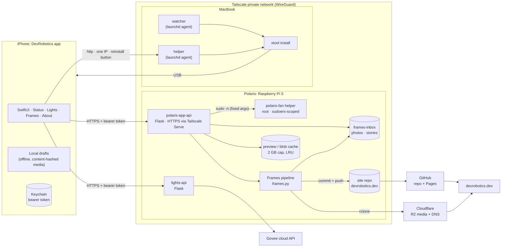
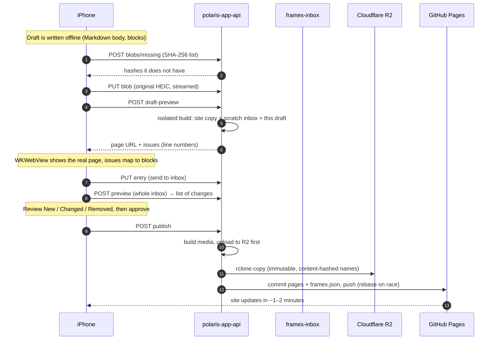
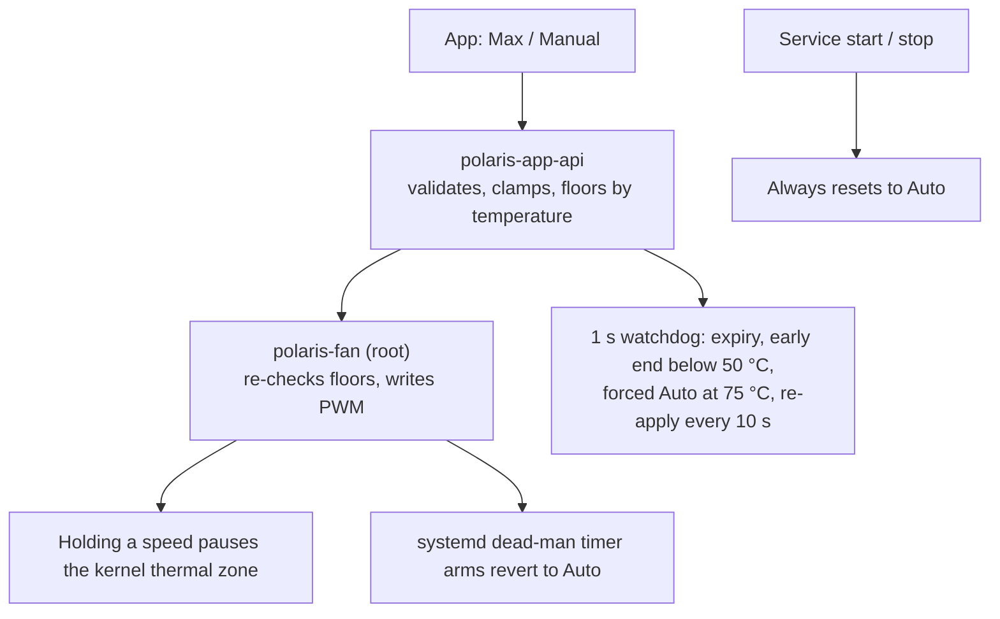
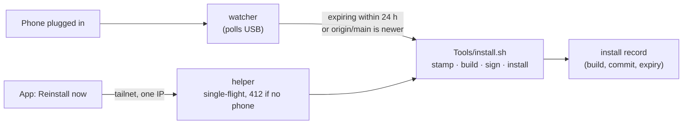

# DevRobotics

A personal iPhone app for my home robotics server, **Polaris**: an always-on Raspberry Pi 5 that maintains
[devrobotics.dev](https://devrobotics.dev), reports its own health, runs my floor lamps, and keeps a public log of
every change it makes. The app gives me status, hardware-safe fan control, lighting scenes, and an offline-first
editor for the photography section (**Frames**) with an exact preview of the live page. Built with SwiftUI for
iOS 26 (Liquid Glass), installed with [xtool](https://github.com/xtool-org/xtool) and SwiftPM, with no Xcode project.

**Hardware:** Raspberry Pi 5 (16 GB, headless, always on) · USB webcam for the flower tracker · two Govee H607C floor
lamps (via Govee's cloud API) · an iPhone and a MacBook as the clients.

| Tab | What it does |
|---|---|
| **Status** | Live Pi health: CPU temperature chart, load, memory, disk, services, **fan control** (Auto / Manual / Max with automatic revert) |
| **Lights** | Two floor lamps: master and per-lamp toggles, brightness, colour temperature, colour, scenes, sleep timer, live state |
| **Frames** | Write photos and stories offline, send them to the Pi, preview the *real* site page for an unsent draft, review, and publish |
| **Settings → About** | Build ID, signing-expiry countdown and reminder, diagnostics, and a button that asks my Mac to reinstall the app |

---

## System design

### Architecture



**Trust model.** The Pi's services are reachable only over the private Tailscale network; every route needs a bearer
token (compared in constant time) that lives in the iOS Keychain and in root-readable files on the machines. Nothing
secret or host-specific is in this repository.

### Components

| Component | Tech | Responsibility |
|---|---|---|
| iOS app | SwiftUI, iOS 26, Swift 6, SwiftPM + xtool | UI, offline drafts, block-based story editor, real-page preview, upload and publish flow |
| `polaris-app-api` | Python 3, Flask, systemd | Status, Frames inbox CRUD, thumbnails, draft preview builds, blob cache + purge, clip previews, fan control |
| `lights-api` | Python 3, Flask | Controls two Govee lamps through the Govee OpenAPI: state, power, brightness, colour, colour temperature, timer |
| `polaris-fan` | Root Python helper + sudoers rule + systemd dead-man timer | The only code that writes the fan's PWM, with its own safety floors |
| Frames pipeline | Python, Pillow, ffmpeg, rclone | HEIC to JPEG/WebP sizes, metadata stripping, clip transcoding, static story pages, R2 upload |
| Mac watcher + helper | Python 3, launchd | Reinstalls the app when the phone is plugged in; serves the app's "Reinstall now" button |

### Key flows

**Writing and publishing a story**



- **Drafts never touch the real inbox** until sent: previews build in a throwaway folder (hard-linked media, symlinked
  entries), so a half-written story can't be published by accident.
- **Publishing is all-or-nothing by design** (the pipeline rebuilds the grid), so the app lists every change first.
- **Media is uploaded before the commit**, so a page never points at a missing file; on failure the working tree is
  restored.

**Fan control (hardware-safe overrides)**



Overrides always expire (Max 15 min, Manual 30 min). A dead service, a dropped phone or a crash can never leave the fan
forced: the root-owned timer returns it to automatic.

**Keeping the app installed (free Apple ID: 7-day signing)**



The agents run from a private clone of this repo, because macOS keeps background agents out of `~/Documents`.

### Design decisions worth explaining

| Decision | Why |
|---|---|
| **Blocks, not a text view** | The story format is already blocks (paragraphs, lists, quotes, media). Parsing to blocks and back is lossless: anything unrecognised stays as plain text. Verified against the real renderer |
| **Pi builds the preview** | The only way to guarantee the in-app preview matches the live page is to run the same template, CSS and Markdown renderer |
| **Content-addressed uploads** | Re-previews upload only photos the Pi doesn't already have |
| **2 GB global cache cap + dead-man timers** | The Pi is a shared home server; previews and overrides must clean up after themselves |
| **Free Apple ID, not paid** | Cheaper; the 7-day limit is absorbed by the auto-reinstall agent |
| **Local-only network model** | No public endpoints: everything rides the private tailnet; the one plain-http link is scoped to a single address |

### Quality and tooling

- **Visual review loop:** `Tools/screenshots.sh` builds for the iOS simulator and captures every screen in light and
  dark with fake demo data (`-demo -screen <name>`), so UI changes are checked by looking at them.
- **Pure-logic harnesses:** `Tools/blockcheck.swift` (Markdown ⇄ blocks round trip against the real pipeline),
  `Tools/problemcheck.swift`, `Tools/aboutcheck.swift`.
- **Design system:** `docs/design.md` (Liquid Glass rules, radii scale, modal/confirmation/feedback conventions) and the
  audits in `docs/audit-*.md`.
- **Contracts:** `docs/draft-preview-contract.md`, `docs/problems-contract.md`.

### Lessons learned

These came from running the system for real, and several shaped the design above.

- **"Online" isn't a status, it's a claim.** A corrupted git object on the Pi once made every status push fail
  silently; the dashboard kept showing *Online* off a three-month-old timestamp. Status is now judged by freshness
  (a missed report shows as offline within 35 minutes), and the app labels cached data as cached.
- **Security in a static site lives somewhere else.** An early version gated the lights behind a browser-side
  password, and the repo published the Pi's backend scripts. Now the backend lives outside the site, every route
  checks a token server-side, and secrets never touch a repo.
- **Small automations need housekeeping.** A status push every five minutes added 34,000+ commits. Reporting every 15
  minutes fixed that; the same instinct drives the 2 GB preview cache cap and the expiring fan overrides.
- **Anything that touches hardware needs a way back.** Every fan override has a root-owned timer that returns it to
  automatic, whatever happens to the service or the phone.
- **OS privacy rules are part of the design.** macOS keeps background agents out of `~/Documents`, so the installer
  agents run from their own clone; iOS blocks plain http unless a single address is explicitly allowed.

---

## Repository layout

```
Sources/DevRobotics/   the iOS app (Status, Lights, Frames, Settings, Core/Design, Core/Demo)
server/                Pi backend: polaris_app_api.py, fan/ (root helper), lights/, systemd units
Tools/                 install.sh, screenshots.sh, check harnesses, mac/ (launchd watcher + helper)
docs/                  design guide, contracts, audits
LICENSES/              bundled font licences (SIL OFL 1.1)
```

## Build and install

```sh
brew install xtool-org/tap/xtool
xtool setup            # one-time Apple login
Tools/install.sh       # stamps build info, builds, signs, installs on a connected iPhone (wraps `xtool dev`)
```

Install through `Tools/install.sh` so the About screen shows the build id, date and signing-expiry countdown.
It also renders `Info.plist` from `Info.template.plist`: put your Mac's Tailscale address (one line) in
`~/Library/Application Support/DevRobotics/mac-host` to enable "Reinstall from my Mac"; the address is never committed.
Optional: `Tools/mac/install-mac-helpers.sh` sets up the launchd agents that reinstall automatically when the phone is
plugged in (`Tools/mac/uninstall-mac-helpers.sh` removes them).

## Fonts

Inter and JetBrains Mono are bundled under the SIL Open Font License 1.1; see `LICENSES/`.
